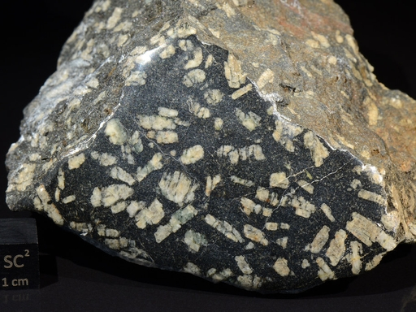
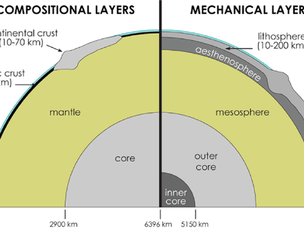
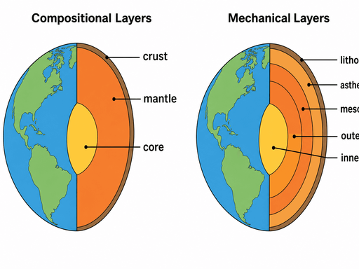
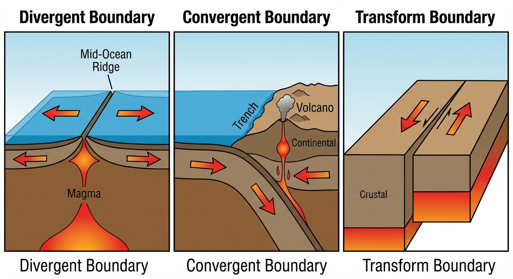
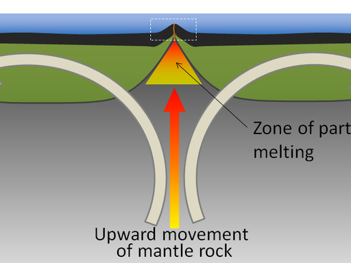
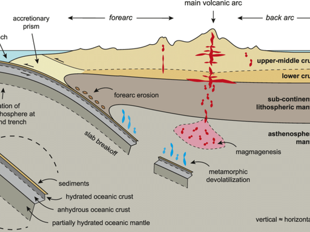
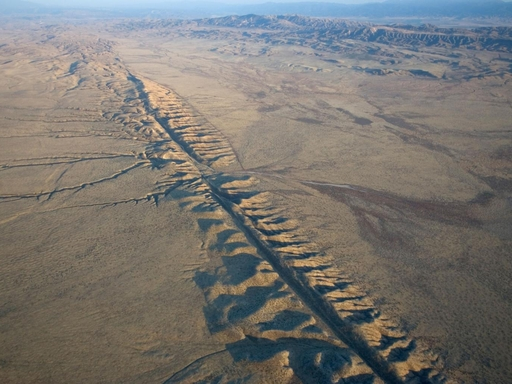
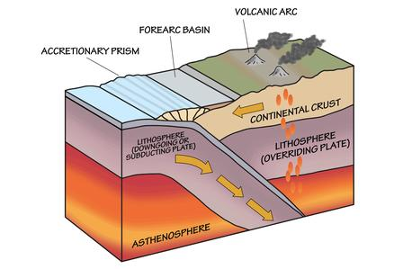
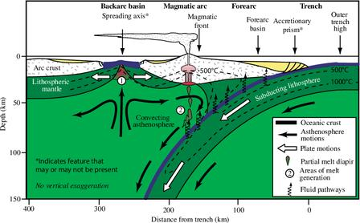

# 矿床品位单位汇总表

| 单位          | 全称/说明                   | 换算关系                       | 常用场景（地质/矿石）       |
| ----------- | ----------------------- | -------------------------- | ----------------- |
| %（wt%，质量分数） | 百分含量                    | 1% = 10000 ppm = 10000 g/t | Cu、Pb、Zn、Fe等主金属   |
| ppm         | parts per million，百万分之一 | 1 ppm = 1 g/t = 1000 ppb   | Mo、Re、W、As等伴生元素   |
| ppb         | parts per billion，十亿分之一 | 1 ppb = 10⁻³ ppm           | Au、铂族、Hg等超痕量元素、化探 |
| g/t         | 克/吨矿石                   | 1 g/t = 1 ppm              | 金矿、斑岩铜矿伴生金属，最常用   |
| μg/g        | 微克/克                    | 1 μg/g = 1 ppm             | 分析检测报告单规范写法       |
| ng/g        | 纳克/克                    | 1 ng/g = 1 ppb             | 高精度痕量分析           |
| oz/t (opt)  | 金衡盎司/短吨                 | 1 oz/t ≈ 34.286 g/t        | 国外金矿资料            |

## 重点数值（咱们前面斑岩铜矿例子）

| 品位描述       | %      | ppm      | g/t      | 1kg矿石里含量 |
| ---------- | ------ | -------- | -------- | -------- |
| 斑岩铜矿经济品位下限 | 0.4%   | 4000 ppm | 4000 g/t | 4 g Cu   |
| 斑岩铜矿经济品位上限 | 0.6%   | 6000 ppm | 6000 g/t | 6 g Cu   |
| 伴生元素示例     | 0.006% | 60 ppm   | 60 g/t   | 0.06 g   |

## 核心换算公式

1. % → ppm（g/t）：数值 × 10000
2. ppm（g/t）→ %：数值 ÷ 10000
3. ppm → ppb：数值 × 1000

> ⚠️备注：固体矿石地质习惯简化：1 ppm ≈1 g/t；液体体系不适用这个简化。

要不要我把这张表做成方便复制到Excel里的版本？  

斑状结构——细粒的基质里镶嵌着几颗粗大的晶体（斑晶）。  
  

#### 👉 按**化学成分（化学分层）**

1. **地壳 Crust**：5–70 km；大陆地壳厚，大洋地壳薄；硅铝 / 硅镁质岩石
2. **地幔 Mantle**：向下至约 2900 km；富镁铁硅酸盐（橄榄岩为主）
3. **地核 Core**：铁镍为主；**外核液态，内核固态**

分界：莫霍面（壳 / 幔）、古登堡面（幔 / 核）

#### 👉 按**力学 / 流变性质（物理分层）**

1. **岩石圈 Lithosphere**：0–约 100 km；刚性、脆性，可以破裂，**= 地壳 + 软流圈之上的上地幔**，板块就是岩石圈块体
2. **软流圈 Asthenosphere**：岩石圈之下；高温、塑性、可缓慢流动（局部少量熔融），岩石圈板块在它上面漂移

  
  
  
  

### ✅ 对应你表格的笔记（和斑岩铜矿成矿绑定）

1. **离散型 divergent（拉张边界）**

板块互相分开，地幔岩浆上涌，生成新洋壳；典型：洋中脊、大陆裂谷；对应SMS海底块状硫化物矿床产出环境。

> 地壳**新生**

2. **汇聚型 convergent（挤压边界｜斑岩铜矿核心）**

板块相向运动，密度大的大洋板片向下俯冲；典型：海沟、火山岛弧、陆缘造山带；俯冲脱水熔融产生岩浆弧，**斑岩铜矿、矽卡岩、浅成低温热液金矿都产于这类边界**。

> 地壳**消亡**

3. **转换型 transform（走滑边界）**

板块水平相互错动，地壳既不生成、也不消亡；典型：转换断层、圣安德烈斯走滑断层；本身不形成大规模斑岩类矿床，但走滑断层可以作为流体通道改造矿体。

> 地壳**守恒**

---

### 分看详图

#### 离散边界（洋中脊，SMS矿床位置）

#### 汇聚边界（俯冲带，斑岩铜矿主场所）

#### 转换边界（圣安德烈斯断层实例）

要不要我把**俯冲带 → 斑岩系统垂向序列（斑岩-高硫化-浅成低温）**的剖面示意图也找给你，串起前面所有矿床类型？  
  
  

### ✅ 俯冲带剖面（和你文字一一对应，论文/笔记用）

从海沟向陆侧依次：

1. **海沟 trench**：大洋板片开始下弯俯冲的位置，大洋最深；采样起点
2. **增生楔 / 弧前 accretionary wedge / forearc**：洋壳上沉积物被刮下来堆叠成楔，弧前盆地就在增生楔和火山弧之间
3. **火山弧 magmatic arc**：俯冲板片脱水，流体上升交代地幔楔、诱发熔融；岩浆向上侵位/喷发，**斑岩铜矿就产于这里**；距离海沟一般100–300 km
4. **弧后盆地 back-arc basin**：火山弧后方拉张扩张，可以生成新生洋壳（你论文新几内亚区域重点）
5. **地幔楔 mantle wedge**：上覆板块之下、俯冲板片之上的楔形地幔，是弧岩浆的源区
6. **贝尼奥夫带 Benioff zone（和达-贝尼奥夫带 Wadati–Benioff）**：俯冲板片内部的倾斜地震带，靠地震定位“看见俯冲板片的形态、倾角”

  
这张带距离、深度刻度，标注了弧后扩张轴、岩浆前锋、流体通道，非常适合理解岩浆成因：俯冲板片脱水→流体进入地幔楔→部分熔融→岩浆上升形成斑岩系统。

红色×代表地震震源，沿着俯冲板片分布，直观理解贝尼奥夫带：地震勾画出俯冲板片的轮廓。

### 📌 一句话串联成笔记（紧扣你的论文）

大洋板块向下俯冲，从海沟往陆：增生楔（刮下来的沉积物）→弧前→火山弧（斑岩Cu-Au主成矿带）→弧后盆地；俯冲板片释放流体，交代上方的地幔楔发生熔融；板片内部地震沿斜面分布，就是贝尼奥夫带。

要不要把**俯冲带 → 斑岩-高硫化-浅成低温热液垂向成矿序列**整合到这个剖面笔记里？